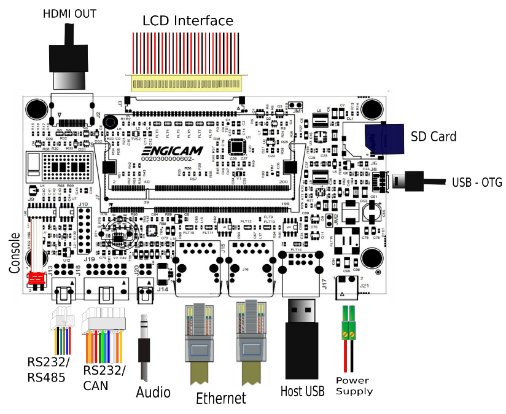

# Test Sheet i.Core RK3568 — CTouch 3.1



## U-Boot

| Status | Test      | Notes                                           |
|--------|-----------|-------------------------------------------------|
| TBT    | Ethernet  | Tested using `ping`                             |
| OK     | SD Card   | Booted system with **JM1** jumper closed        |
| OK     | eMMC      | Booted system with **JM1** jumper open          |
| TBT    | USB       | Tested with `usb start`, `usb tree`, `usb stop` |


## Kernel Linux tests

| Status | Test                 | Note             |
| ------ | -------------------- | ---------------- |
| OK     | Ethernet 0 (J14)     |                  |
| OK     | Ethernet 1 (J15)     |                  |
| OK     | USB 2.0 (J17)        |                  |
| OK     | SD card (JM1 closed) |                  |
| OK     | eMMC card (JM1 open) | boot from sdcard |
| OK     | UART 232  (J18)      |                  |
| TBT    | UART 485  (J18)      |                  |
| OK     | Linux Console (J13)  |                  |
| OK     | WIFI                 |                  |
| TBT    | BLUETOOTH            |                  |
| OK     | RTC                  |                  |
| OK     | Reboot               |                  |
| OK     | LVDS (J3)            |                  |
| OK     | Backlight            |                  |
| OK     | Touchscreen          |                  |
| OK     | Audio (J20)          |                  |
| OK     | HDMI (J2)            |                  |
| OK     | CAN 0 (J19)          |                  |
| TBT    | CAN 1 (J19)          |IF up             |
| OK     | GPU                  |                  |
| OK     | VPU                  |                  |

### eth0

```
eth0: flags=4163<UP,BROADCAST,RUNNING,MULTICAST>  mtu 1500
        inet 10.24.1.32  netmask 255.255.254.0  broadcast 10.24.1.255
        inet6 fe80::6c5d:cfff:fe94:596f  prefixlen 64  scopeid 0x20<link>
        ether 6e:5d:cf:94:59:6f  txqueuelen 1000  (Ethernet)
        RX packets 601  bytes 55832 (54.5 KiB)
        RX errors 0  dropped 1  overruns 0  frame 0
        TX packets 31  bytes 5298 (5.1 KiB)
        TX errors 0  dropped 0 overruns 0  carrier 0  collisions 0
        device interrupt 102  

```

#### eth1

```bash
root@rk3568-icore:~# ifconfig eth1 up
root@rk3568-icore:~# udhcpc -i eth1
udhcpc: started, v1.36.1
udhcpc: broadcasting discover
udhcpc: broadcasting select for 10.24.1.55, server 10.24.0.131
udhcpc: lease of 10.24.1.55 obtained from 10.24.0.131, lease time 3600
/etc/udhcpc.d/50default: Adding DNS 10.24.0.131
/etc/udhcpc.d/50default: Adding DNS 10.24.0.132
```


### USB

```bash

root@rk3568-icore:~# lsusb -t
/:  Bus 001.Port 001: Dev 001, Class=root_hub, Driver=xhci-hcd/1p, 480M
/:  Bus 002.Port 001: Dev 001, Class=root_hub, Driver=xhci-hcd/1p, 5000M
/:  Bus 003.Port 001: Dev 001, Class=root_hub, Driver=ehci-platform/1p, 480M
/:  Bus 004.Port 001: Dev 001, Class=root_hub, Driver=ohci-platform/1p, 12M
/:  Bus 005.Port 001: Dev 001, Class=root_hub, Driver=ehci-platform/1p, 480M
/:  Bus 006.Port 001: Dev 001, Class=root_hub, Driver=ohci-platform/1p, 12M
/:  Bus 007.Port 001: Dev 001, Class=root_hub, Driver=xhci-hcd/1p, 480M
    |__ Port 001: Dev 002, If 0, Class=Hub, Driver=hub/4p, 480M
        |__ Port 003: Dev 004, If 0, Class=Mass Storage, Driver=usb-storage, 480M
/:  Bus 008.Port 001: Dev 001, Class=root_hub, Driver=xhci-hcd/1p, 5000M
```


```bash
root@rk3568-icore:~# lsusb -t
/:  Bus 001.Port 001: Dev 001, Class=root_hub, Driver=xhci-hcd/1p, 480M
/:  Bus 002.Port 001: Dev 001, Class=root_hub, Driver=xhci-hcd/1p, 5000M
/:  Bus 003.Port 001: Dev 001, Class=root_hub, Driver=ehci-platform/1p, 480M
/:  Bus 004.Port 001: Dev 001, Class=root_hub, Driver=ohci-platform/1p, 12M
/:  Bus 005.Port 001: Dev 001, Class=root_hub, Driver=ehci-platform/1p, 480M
/:  Bus 006.Port 001: Dev 001, Class=root_hub, Driver=ohci-platform/1p, 12M
/:  Bus 007.Port 001: Dev 001, Class=root_hub, Driver=xhci-hcd/1p, 480M
    |__ Port 001: Dev 002, If 0, Class=Hub, Driver=hub/4p, 480M
        |__ Port 001: Dev 005, If 0, Class=Mass Storage, Driver=usb-storage, 480M
/:  Bus 008.Port 001: Dev 001, Class=root_hub, Driver=xhci-hcd/1p, 5000M
```


### RTC

```bash
[    7.067059] rtc-pcf8523 4-0068: registered as rtc0
[    7.067599] rtc-pcf8523 4-0068: setting system clock to 2018-03-09T18:28:01 UTC (1520620081)
```


### Backlight

```bash
echo 100 > /sys/class/backlight/backlight/brightness 
echo 255 > /sys/class/backlight/backlight/brightness 
```


### CanBus

```bash
#Configure the bit rate on target:
ip link set can0 type can bitrate 125000
ip link set can1 type can bitrate 125000
#Enable the interface on target:
ifconfig can0 up
ifconfig can1 up
#To receive a frame:
cantest can0 &
#To send a frame:
cantest can1 5A1#11.2233.44556677.88
#To receive a frame:
cantest can1 &
#To send a frame:
cantest can0 5A1#11.2233.44556677.88
```

### gpu

```bash
export XDG_RUNTIME_DIR=/run/user/1000
export WAYLAND_DISPLAY=wayland-0
glmark2-es2-wayland 
arm_release_ver: g13p0-01eac0, rk_so_ver: 11
=======================================================
    glmark2 2023.01
=======================================================
    OpenGL Information
    GL_VENDOR:      ARM
    GL_RENDERER:    Mali-G52
    GL_VERSION:     OpenGL ES 3.2 v1.g13p0-01eac0.98c5dad4e3309b873e3189000b74ea36
    Surface Config: buf=32 r=8 g=8 b=8 a=8 depth=24 stencil=0 samples=0
    Surface Size:   800x600 windowed
=======================================================
```


#### vpu

```bash
wget -O sample_1080p.mp4 "https://raw.githubusercontent.com/mediaelement/mediaelement-files/master/big_buck_bunny.mp4"

export XDG_RUNTIME_DIR=/var/run/user/1000/
gst-play-1.0 sample_1080p.mp4 --videosink=waylandsink

```


#### RS232

```python
import os, termios, time, sys, select
dev="/dev/ttyS7"
B={9600:termios.B9600,19200:termios.B19200,38400:termios.B38400,57600:termios.B57600,115200:termios.B115200,230400:termios.B230400,460800:termios.B460800,921600:termios.B921600,1500000:termios.B1500000}

fd=os.open(dev,os.O_RDWR|os.O_NOCTTY|os.O_NONBLOCK)

def setup(b):
    a=termios.tcgetattr(fd)
    a[0]=0; a[1]=0; a[2]=termios.CS8|termios.CREAD|termios.CLOCAL; a[3]=0
    a[4]=a[5]=B[b]; a[6][termios.VMIN]=0; a[6][termios.VTIME]=0
    termios.tcsetattr(fd,termios.TCSANOW,a); termios.tcflush(fd,termios.TCIOFLUSH)

def xfer(data,b):
    sent=0; got=b""; t=time.time()+max(2,len(data)*10/b*3)
    while len(got)<len(data) and time.time()<t:
        w=[fd] if sent<len(data) else []
        r,w,_=select.select([fd],w,[],0.1)
        if w: sent+=os.write(fd,data[sent:])
        if r: got+=os.read(fd,4096)
    return got

ok=True
for b in B:
    setup(b)
    data=bytes(range(256))*(64 if b>=115200 else 4)
    got=xfer(data,b)
    good=got==data
    err=sum(1 for x,y in zip(data,got) if x!=y)
    print(f"{b:>8} baud: sent {len(data):5d} recv {len(got):5d} {'OK' if good else 'FAIL'} mismatch={err}")
    ok&=good
os.close(fd); print("RESULT:", "PASS" if ok else "FAIL")

```


#### Audio


```bash
root@rk3568-icore:~# aplay -L
null
    Discard all samples (playback) or generate zero samples (capture)
default:CARD=rk3568icoreI2Sc
    rk3568-icore,I2S-codec, fe430000.i2s-tas2780 ASI1 tas2780 ASI1-0
    Default Audio Device
sysdefault:CARD=rk3568icoreI2Sc
    rk3568-icore,I2S-codec, fe430000.i2s-tas2780 ASI1 tas2780 ASI1-0
    Default Audio Device

```


#### WiFi

```bash
ifconfig -a

mlan0: flags=4098<BROADCAST,MULTICAST>  mtu 1500
        ether 34:32:e6:2f:c9:df  txqueuelen 1000  (Ethernet)
        RX packets 0  bytes 0 (0.0 B)
        RX errors 0  dropped 0  overruns 0  frame 0
        TX packets 0  bytes 0 (0.0 B)
        TX errors 0  dropped 0 overruns 0  carrier 0  collisions 0

ifconfig mlan0 up

iw mlan0 scan | grep SSID:
	SSID: engicam_guest
	SSID: engicam
	SSID: engicam-ent
```

Connection Test

```bash
wpa_passphrase <ssid>> <password> > /etc/wpa_mlan0.conf
wpa_supplicant -B -i mlan0 -c /etc/wpa_mlan0.conf
udhcpc -i mlan0

wget -O sample_1080p.mp4 "https://raw.githubusercontent.com/mediaelement/mediaelement-files/master/big_buck_bunny.mp4"
```