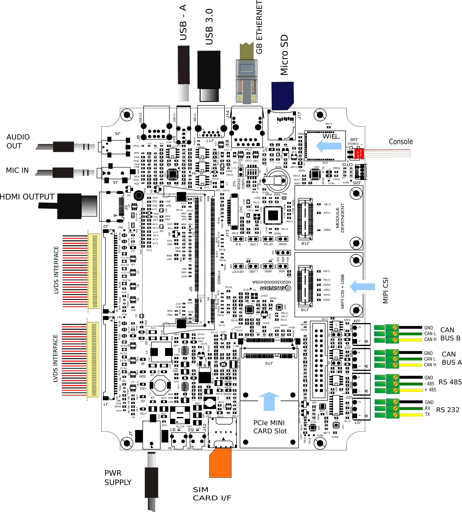

# Test Sheet i.Core RK3568 — EDIMM Starterkit 2.0



## U-Boot

| Status | Test      | Notes                                           |
|--------|-----------|-------------------------------------------------|
| TBT    | Ethernet  | Tested using `ping`                             |
| OK     | SD Card   | Booted system with **JM1** jumper closed        |
| OK     | eMMC      | Booted system with **JM1** jumper open          |
| TBT    | USB       | Tested with `usb start`, `usb tree`, `usb stop` |

---

## Kernel

| Status | Test                        | Notes                                              |
|--------|-----------------------------|----------------------------------------------------|
| OK     | GMAC 0                      | Network communication                              |
| OK     | GMAC 1                      | Network communication                              |
| OK     | USB2                        | Tested with USB stick on J8/J10                    |
| OK     | USB3                        | Tested with USB stick on J11                       |
| OK     | SD Card                     | Booted system from SD card. JM1 closed             |
| OK     | eMMC                        | Booted system from eMMC. JM1 open                  |
| OK     | UART 232                    | J21 UART7                                          |
| TBT    | UART 485                    | J22 UART0                                          |
| OK     | Linux Console               | Console I/O working                                |
| OK     | Touchscreen                 | Manually tested                                    |
| OK     | LVDS 0                      | Display output working                             |
| OK     | HDMI                        | Display output working                             |
| OK     | Backlight Control           |                                                    |
| OK     | AUDIO                       | Tested with `aplay` and `arecord`                  |
| TBT    | PCI-e                       |                                                    |
| OK     | Wi-Fi                       |                                                    |
| OK     | Bluetooth                   |                                                    |
| TBT    | MIPI-CSI                    |                                                    |
| OK     | CAN_BUS_A / CAN_BUS_B       |                                                    |
| OK     | Reboot                      |                                                    |
| OK     | Reboot Button               |                                                    |
| OK     | RTC                         |                                                    |
| OK     | NPU                         | Detected in `dmesg`. No functional test performed. |
| OK     | GPU                         | Tested with `glmark2` under Weston                 |
| OK     | VPU                         | Tested with GStreamer under Weston                 |
| OK     | PCAL6416                    |                                                    |

---

## Debug Console

The console port is on J26 at 1500000 8n1:

```bash
tio /dev/ttyUSB0 -b 1500000
```

---

## Wi-Fi

The `brcmfmac.ko` driver must be loaded manually:

```bash
ifconfig wlan0 up
iw dev wlan0 scan | grep SSID
```

---

## Bluetooth

```bash
brcm_patchram_plus --patchram /etc/firmware/BCM43430A1.1DX.hcd --enable_hci \
--no2bytes --tosleep 50000 --baudrate 1000000 \
--use_baudrate_for_download /dev/ttyUSB0 &

hciconfig hci0 up
bluetoothctl
# scan on
```

---

## CAN Interfaces

- **CAN1 → J23** → SOM pin 119 RX / 118 TX → `CAN0_TX_M0`
- **CAN2 → J24** → SOM pin 121 RX / 120 TX → `CAN2_RX_M0`

```bash
ip link set can0 type can bitrate 125000
ip link set can1 type can bitrate 125000
ifconfig can0 up
ifconfig can1 up

cantest can0 &
cantest can1 5A1#11.2233.44556677.88
```
