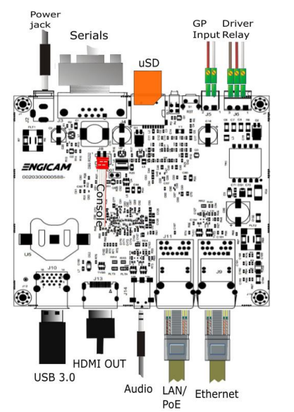
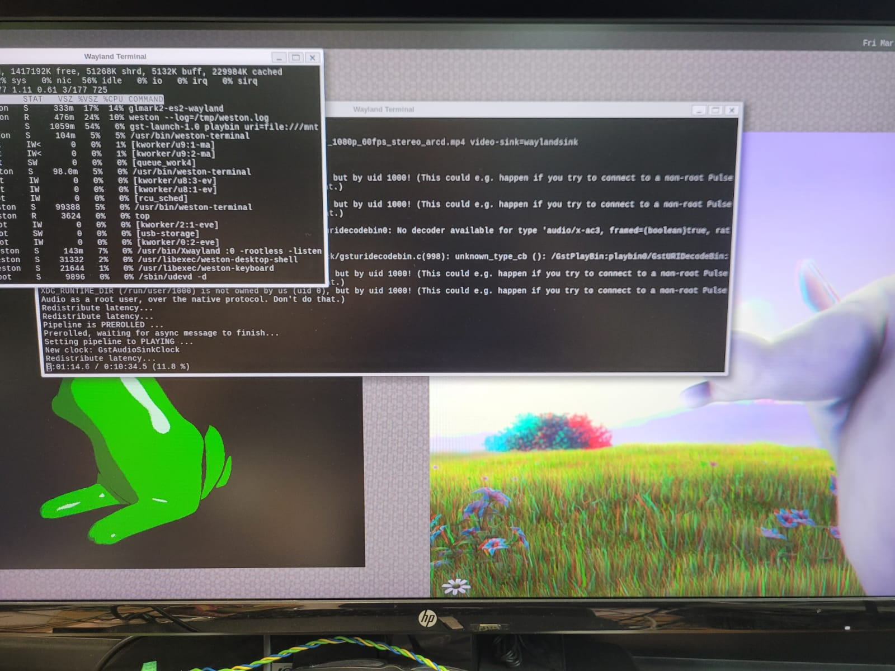

 # rk3568-vboard hardware debug



## debug console 

The console port is on J8. With the criteria:

115200 8,n,1

es.

```bash
tio /dev/ttyUSB0 -b 115200
```

## RS232 on J3

tested with minicom minicom on device:

	 /dev/ttyS0

## Input J5

Pin number = (gpio_letter * 8 ) + gpio_index
GPIO4_C2
2 * 8 + 3 = 19


````
echo 147 > /sys/class/gpio/export 
echo in > /sys/class/gpio/gpio147/direction 
cat /sys/class/gpio/gpio147/value 
````

## USB 3.0

tested with usb stick activity.

## Rele output on J6

Pin number = (gpio_letter * 8 ) + gpio_index
GPIO4_C2
2 * 8 + 2 = 18


````
echo 146 > /sys/class/gpio/export 
echo out > /sys/class/gpio/gpio146/direction 
echo 1 > /sys/class/gpio/gpio146/value 
echo 0 > /sys/class/gpio/gpio146/value 
````

## Led DL1

Set as system heartbeat

````
led@1 {
	gpios = <&gpio0 19 GPIO_ACTIVE_HIGH>;
	label = "SYS_RUN";
	linux,default-trigger = "heartbeat";
};
````

## Audio on J14

tested on debian


## ethernet

Tested with ethernet activity

````
root@vitobox-rk3568:~# ifconfig
eth0      Link encap:Ethernet  HWaddr 46:41:AC:CF:6D:AF  
          inet addr:10.24.1.19  Bcast:10.24.1.255  Mask:255.255.254.0
          inet6 addr: fe80::4441:acff:fecf:6daf/64 Scope:Link
          UP BROADCAST MULTICAST  MTU:1500  Metric:1
          RX packets:1509 errors:0 dropped:3 overruns:0 frame:0
          TX packets:26 errors:0 dropped:0 overruns:0 carrier:0
          collisions:0 txqueuelen:1000 
          RX bytes:158923 (155.1 KiB)  TX bytes:4318 (4.2 KiB)
          Interrupt:44 

lo        Link encap:Local Loopback  
          inet addr:127.0.0.1  Mask:255.0.0.0
          inet6 addr: ::1/128 Scope:Host
          UP LOOPBACK RUNNING  MTU:65536  Metric:1
          RX packets:11 errors:0 dropped:0 overruns:0 frame:0
          TX packets:11 errors:0 dropped:0 overruns:0 carrier:0
          collisions:0 txqueuelen:1000 
          RX bytes:1682 (1.6 KiB)  TX bytes:1682 (1.6 KiB)

root@vitobox-rk3568:~# ifconfig  eth0 down
root@vitobox-rk3568:~# ifconfig  eth1 up  
[ 2258.841952] rk_gmac-dwmac fe2a0000.ethernet eth1: Register MEM_TYPE_PAGE_POOL RxQ-0
[ 2258.845447] rk_gmac-dwmac fe2a0000.ethernet eth1: PHY [stmmac-0:01] driver [MXL86110 Gigabit Ethernet] (irq=POLL)
[ 2258.845550] dwmac4: Master AXI performs any burst length
[ 2258.845603] rk_gmac-dwmac fe2a0000.ethernet eth1: No Safety Features support found
[ 2258.845677] rk_gmac-dwmac fe2a0000.ethernet eth1: IEEE 1588-2008 Advanced Timestamp supported
[ 2258.846450] rk_gmac-dwmac fe2a0000.ethernet eth1: registered PTP clock
[ 2258.847594] rk_gmac-dwmac fe2a0000.ethernet eth1: configuring for phy/rgmii link mode
root@vitobox-rk3568:~# 
root@vitobox-rk3568:~# [ 2262.897988] rk_gmac-dwmac fe2a0000.ethernet eth1: Link is Up - 1Gbps/Full - flow control off
[ 2262.898161] IPv6: ADDRCONF(NETDEV_CHANGE): eth1: link becomes ready

root@vitobox-rk3568:~# udhcpc -i eth1
udhcpc: started, v1.36.1
udhcpc: broadcasting discover
udhcpc: broadcasting select for 10.24.1.21, server 10.24.0.1
udhcpc: lease of 10.24.1.21 obtained from 10.24.0.1, lease time 43200
/etc/udhcpc.d/50default: Adding DNS 10.24.0.5
/etc/udhcpc.d/50default: Adding DNS 10.24.0.11

root@vitobox-rk3568:~# ifconfig
eth1      Link encap:Ethernet  HWaddr 42:41:AC:CF:6D:AF  
          inet addr:10.24.1.21  Bcast:10.24.1.255  Mask:255.255.254.0
          inet6 addr: fe80::4041:acff:fecf:6daf/64 Scope:Link
          UP BROADCAST RUNNING MULTICAST  MTU:1500  Metric:1
          RX packets:2783 errors:0 dropped:1 overruns:0 frame:0
          TX packets:31 errors:0 dropped:0 overruns:0 carrier:0
          collisions:0 txqueuelen:1000 
          RX bytes:272694 (266.3 KiB)  TX bytes:4694 (4.5 KiB)
          Interrupt:46 

lo        Link encap:Local Loopback  
          inet addr:127.0.0.1  Mask:255.0.0.0
          inet6 addr: ::1/128 Scope:Host
          UP LOOPBACK RUNNING  MTU:65536  Metric:1
          RX packets:15 errors:0 dropped:0 overruns:0 frame:0
          TX packets:15 errors:0 dropped:0 overruns:0 carrier:0
          collisions:0 txqueuelen:1000 
          RX bytes:2030 (1.9 KiB)  TX bytes:2030 (1.9 KiB)

````


## GPU and VPU

tested with wayland:




with tools:

```
glmark2-es2-wayland

gst-launch-1.0 playbin uri=file:///mnt/bbb_sunflower_1080p_60fps_stereo_arcd.mp4 video-sink=waylandsink
```